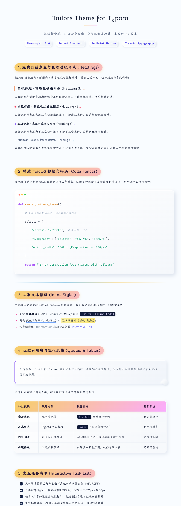
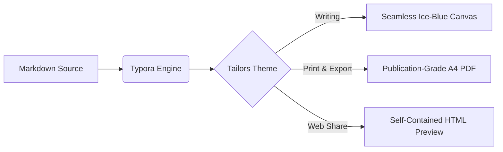

# Tailors — Elegant Neumorphic & Sunset Twilight Theme for Typora

<p align="center">
  <b>Sunset Twilight Gradients × Neumorphism 2.0 Tactile Depth × Gentle Ice-Blue Canvas × Publication-Grade A4 Pagination</b>
</p>

<p align="center">
  <a href="https://chiamzhang.github.io/html/Typora-Theme-Tailors%20%20Introduction.html">🌐 Live Preview</a> •
  <a href="https://github.com/ChiamZhang/TyporaTheme-Tailors">🏠 GitHub Repository</a> •
  <a href="Typora-Theme-Tailors%20中文介绍.md">🇨🇳 完整中文介绍 (Chinese Doc)</a> •
  <a href="https://github.com/ChiamZhang/TyporaTheme-Tailors/archive/refs/heads/main.zip">⬇️ Download Theme (ZIP)</a> •
  <a href="https://github.com/ChiamZhang/TyporaTheme-Tailors/issues">💬 Issues & Feedback</a>
</p>

<p align="center">
  
</p>

---

## 🔗 Quick Links

- **🌐 Live Preview**: [https://chiamzhang.github.io/html/Typora-Theme-Tailors%20%20Introduction.html](https://chiamzhang.github.io/html/Typora-Theme-Tailors%20%20Introduction.html)
- **⭐ GitHub Repository**: [https://github.com/ChiamZhang/TyporaTheme-Tailors](https://github.com/ChiamZhang/TyporaTheme-Tailors)
- **⬇️ Direct Download**: [TyporaTheme-Tailors.zip](https://github.com/ChiamZhang/TyporaTheme-Tailors/archive/refs/heads/main.zip)
- **🇨🇳 Chinese Documentation**: [Typora-Theme-Tailors 中文介绍.md](Typora-Theme-Tailors%20中文介绍.md)

---

## 📖 Design Philosophy

**Tailors** is a publication-grade Typora theme combining the aesthetic spirit of **Phycat** (Sunset Twilight gradients) with **Typora-Theme-Neumorphism** (soft tactile depth and 3D micro-interactions).

- **Full-Bleed Gentle Ice-Blue Canvas**: The editing canvas and print background share a warm, muted ice-blue hue (`#F9FCFF`), completely eliminating glaring pure white reflection.
- **Pure Seamless Canvas**: The editor canvas flows seamlessly into the window background without jarring card borders or harsh gray dropshadows, ensuring an immersive writing environment.
- **Neumorphism 2.0 Tactile Depth**: Concave inline code chips, embossed `<var>` pill badges, and tactile 3D checkboxes.
- **Publication-Grade A4 Printing & Export**: Text defaults to Chinese XiaoSi / 12pt (16px), with algorithms eliminating unwanted multi-page blank gaps during PDF export.

---

## 📑 Table of Contents

[TOC]

---

# 1. Heading Visual Hierarchy

<p align="center">
  
</p>

Tailors features a meticulously calibrated **Sunset Twilight** chromatic progression, pairing distinct geometric accents with custom gradient typography:

## 1.1 Level 2 Subheading Capsule

Level 2 headings feature an iconic sunset gradient capsule `linear-gradient(135deg, #f7ce68, #fbabfe)` with soft volumetric ambient glow, serving as the primary chapter dividers.

### 1.1.1 Level 3 Heading (Coral Sunset)

Level 3 headings are bathed in warm sunset coral (`#ea580c`), accompanied by a refined dot array accent at the trailing edge.

#### 1.1.1.1 Level 4 Heading (Twilight Rose)

Level 4 headings transition smoothly into twilight rose pink (`#f43f5e`), accented by a subtle four-dot cluster.

##### 1.1.1.1.1 Level 5 Heading (Iris Violet)

Level 5 headings adopt a regal iris violet (`#8b5cf6`), paired with a five-dot constellation.

###### 1.1.1.1.1.1 Level 6 Heading (Sky Blue)

Level 6 headings gracefully conclude with minimalistic sky blue (`#0284c7`), preserving clarity without visual noise.

---

# 2. Inline Typography & Neumorphism 2.0

<p align="center">
  
</p>

Every Markdown inline element in Tailors has been ergonomically and aesthetically tuned:

- **Bold**: **Deep midnight-blue weight enhancement for crisp readability**
- *Italic*: *Classic humanist italics, refined and literary*
- <u>Underline</u>: <u>Suspended `#3b82f6` sky-blue line, saying goodbye to drab black rules</u>
- ~~Strikethrough~~: ~~Deprecated or revised content with a smooth, muted slate tint~~
- ==Highlight==: ==Soft amber warm-sun glow, preventing fatigue during long reading sessions==
- Inline Code: `console.log("Tailors Neumorphism 2.0")`, sculpted with concave recessed tactile styling
- Superscript & Subscript: Mass-energy equivalence $E = mc^2$, water H~2~O, coordinate spheres $X^2 + Y^2 + Z^2 = R^2$
- Hyperlinks: [Tailors GitHub Repository](https://github.com/ChiamZhang/TyporaTheme-Tailors), featuring smooth animated gradient hover rules
- Footnotes: Full academic citation footnote support[^tailors-footnote].

[^tailors-footnote]: This is a standard academic footnote in Tailors, featuring smooth anchor return and soft embossed capsule hover bubbles.

### 2.1 Neumorphic `<var>` Tactile Embossed Badges

Wrap text with the `<var>` tag to render Neumorphism 2.0 tactile pill badges:

- <var> CLI Option: --output-format=pdf </var>
- <var> Core Engine: A4 Page-Break Pagination Optimization </var>
- <var> Base Color: #F9FCFF Ice-Blue Canvas </var>
- Hover over <var> Hover over this pill </var> to feel the physical pressed tactile sensation!

---

# 3. Blockquotes & Floating Spheres

Blockquotes feature a soft neumorphic embossed panel adorned with dual sunset micro-spheres in the lower-right corner, gently shifting from twilight gold to deep sea blue on hover:

> "The true journey of discovery consists not in seeking new landscapes, but in having new eyes."
> 
> *— Classic single-tier quotation. Accompanied by soft ambient neumorphic spheres for an immersive reading experience.*

Multi-tier nested quotes are fully supported:

> Level 1 Quote: Seamless integration of aesthetic philosophy and engineering precision.
>
> > Level 2 Nested Quote: Replaces heavy solid bars with sleek warm orange indicator lines, keeping hierarchy crisp and airy.

---

# 4. Lists & 3D Tactile Task Checkboxes

<p align="center">
  
</p>

### 4.1 3D Tactile Task Checkboxes

Tailors swaps default flat browser checkboxes for 3D tactile neumorphic micro-switches:

- [ ] **Pending Task**: Elevated tactile white button with diffuse ambient shadow;
- [x] **Completed Task**: Recessed concave pit with a clean checkmark and elegant strikethrough;
- [ ] Cross-platform verification (macOS / Windows / Linux);
- [x] Full optimization of A4 print and PDF page-break algorithms.

### 4.2 Multi-Level Ordered and Unordered Lists

1. Phase 1: Conceptualization & Color Engineering
   1. Extract sunset twilight chromatic range (`#f7ce68` → `#fbabfe`)
   2. Establish gentle ice-blue canvas (`#F9FCFF`)
2. Phase 2: Typesetting & Structural Refinement
   - [x] Fix excessive blank space on multi-page PDF exports
   - [x] Refactor H1 through H6 geometric visual indicators
   - [ ] Expand multi-language syntax highlighting themes
3. Phase 3: Community Release & Documentation

---

# 5. Sunset Gradient Tables

<p align="center">
  
</p>

Table headers showcase smooth sunset gradient tones with rounded corners, gentle zebra striping across alternate rows, and subtle hover elevation with warm amber accent glow:

| Feature Dimension | Default Theme Limitations | Tailors 2.0 Enhancement | Status |
| :--- | :---: | :--- | :---: |
| **Canvas Background** | Glaring `#ffffff` pure white | Warm Ice-Blue `#F9FCFF`, soft on eyes | <var>Ready</var> |
| **A4 PDF Export** | Multi-page large blank gaps | Natural compact flow, zero layout break | <var>Publication-Grade</var> |
| **Page Boundaries** | Heavy dark-gray card boxes | Seamless borderless canvas, pure immersion | <var>Seamless</var> |
| **Code Blocks** | Rigid, flat code fences | macOS Traffic Light buttons + frosted shadow | <var>Implemented</var> |
| **Numeric Data** | Inconsistent tabular digits | Monospaced numeric figures for clean tabular alignment | `$99,880.00` |

---

# 6. Code Fences & Syntax Highlighting

<p align="center">
  
</p>

Every code block is crowned with **macOS traffic light buttons (Red, Amber, Green)** on a soft frosted dark backdrop, delivering top-tier code reading comfort:

### 6.1 Python Data Science Example

```python
import numpy as np
import matplotlib.pyplot as plt

def sunset_gradient(n_steps: int = 100) -> np.ndarray:
    """Generate Tailors theme sunset twilight chromatic vector space."""
    start_color = np.array([247, 206, 104]) / 255.0  # #f7ce68
    end_color = np.array([251, 171, 254]) / 255.0    # #fbabfe
    return np.linspace(start_color, end_color, n_steps)

if __name__ == "__main__":
    colors = sunset_gradient()
    print(f"Tailors gradient initialized with {len(colors)} chromatic steps.")
```

### 6.2 Modern C++ / Rust Implementation

```cpp
#include <iostream>
#include <string_view>
#include <vector>

template <typename T>
concept PrintableTheme = requires(T t) {
    { t.render() } -> std::same_as<void>;
};

struct TailorsTheme {
    std::string_view name = "Tailors";
    double version = 2.0;

    void render() const {
        std::cout << "Rendering " << name << " v" << version 
                  << " with sunset twilight palette.\n";
    }
};

int main() {
    TailorsTheme theme;
    theme.render();
    return 0;
}
```

```rust
pub struct PageLayout {
    pub canvas_color: &'static str,
    pub font_size_pt: f32,
    pub is_seamless: bool,
}

impl Default for PageLayout {
    fn default() -> Self {
        Self {
            canvas_color: "#F9FCFF",
            font_size_pt: 12.0, // XiaoSi standard
            is_seamless: true,
        }
    }
}
```

---

# 7. Mathematical Typography

Tailors provides full support for $\LaTeX$, MathJax, and KaTeX notation, rendering crisp, balanced math typography:

### 7.1 Inline Math

The mass-energy equivalence is $E = mc^2$, Euler's identity is $e^{i\pi} + 1 = 0$, and the normal distribution density function is $f(x) = \frac{1}{\sigma\sqrt{2\pi}} e^{-\frac{(x-\mu)^2}{2\sigma^2}}$.

### 7.2 Block Math

$$\int_{-\infty}^{+\infty} e^{-x^2} \, dx = \sqrt{\pi}$$

$$\nabla \times \mathbf{E} = -\frac{\partial \mathbf{B}}{\partial t}, \quad \nabla \times \mathbf{B} = \mu_0 \mathbf{J} + \mu_0 \varepsilon_0 \frac{\partial \mathbf{E}}{\partial t}$$

$$\mathcal{L} = \mathbb{E}_{q(\mathbf{z}|\mathbf{x})}[\log p(\mathbf{x}|\mathbf{z})] - D_{\mathrm{KL}}(q(\mathbf{z}|\mathbf{x}) \parallel p(\mathbf{z}))$$

---

# 8. Diagrams & Flowcharts (Mermaid)

Mermaid diagrams are housed on a gentle neumorphic card with clean edges and inherited typography:



---

# 9. Images & Sizing Shortcuts

Tailors enables rapid image scaling by appending dimensions to the `alt` or `title` attribute:

1. **Scale to 50% width**: ``
2. **Scale to 30% width**: ``
3. **Supported increments**: `0, 5, 10, 15, ..., 100`


---

# 10. Dual Themes & Installation Guide

Tailors natively delivers a **Dual Theme System**, sharing the same premium bundled typography:
- ☀️ **Tailors (Light / Gentle Ice-Blue)**: `tailors.css`, engineered for focused daytime writing.
- 🌙 **Tailors Dark (Dark / Deep Twilight)**: `tailors-dark.css`, an immersive anti-glare nighttime experience.
- 🖨️ **Smart Toner Protection**: Regardless of whether you write in light or dark mode, **PDF exports and physical printing automatically switch to pure white paper mode** (preventing wasted black ink/toner), while HTML web exports preserve the full fidelity of dark mode!

### 10.1 Installation

1. **[Download the Latest Theme Package (ZIP)](https://github.com/ChiamZhang/TyporaTheme-Tailors/archive/refs/heads/main.zip)** and extract it.
2. Open Typora and navigate to the Theme Folder:
   - **macOS**: `Preferences` → `Appearance` → `Open Theme Folder`
   - **Windows / Linux**: `File` → `Preferences` → `Appearance` → `Open Theme Folder`
3. Copy the following items into the Theme Folder:
   - `tailors.css` (Light Theme)
   - `tailors-dark.css` (Dark Theme)
   - `tailors` (Fonts & assets directory)
4. Restart Typora, then choose **Tailors** or **Tailors Dark** from the **Themes** menu.

### 10.2 Exporting to HTML / PDF

- **Export HTML**: Navigate to **File ➔ Export ➔ HTML (with styles)** to preserve the full selected theme styling.
- **Export PDF / Print**: Navigate to **File ➔ Export ➔ PDF** to automatically engage `@media print` paper mode and compact A4 pagination.

---

## 💡 Credits & License

- Inspired by:
  - [Phycat](https://github.com/sumruler/typora-theme-phycat) by XuJilong (Heading design and sunset twilight aesthetics)
  - [Typora-Theme-Neumorphism](https://github.com/Soanguy/Typora-Theme-Neumorphism) by Soanguy (Tactile neumorphic inline elements)
- Typography: Bellota, Tw Cen MT, LXGW WenKai, STSong, HYHuaGuan
- Released under the [MIT License](LICENSE). Stars and issue feedback are warmly welcomed!
