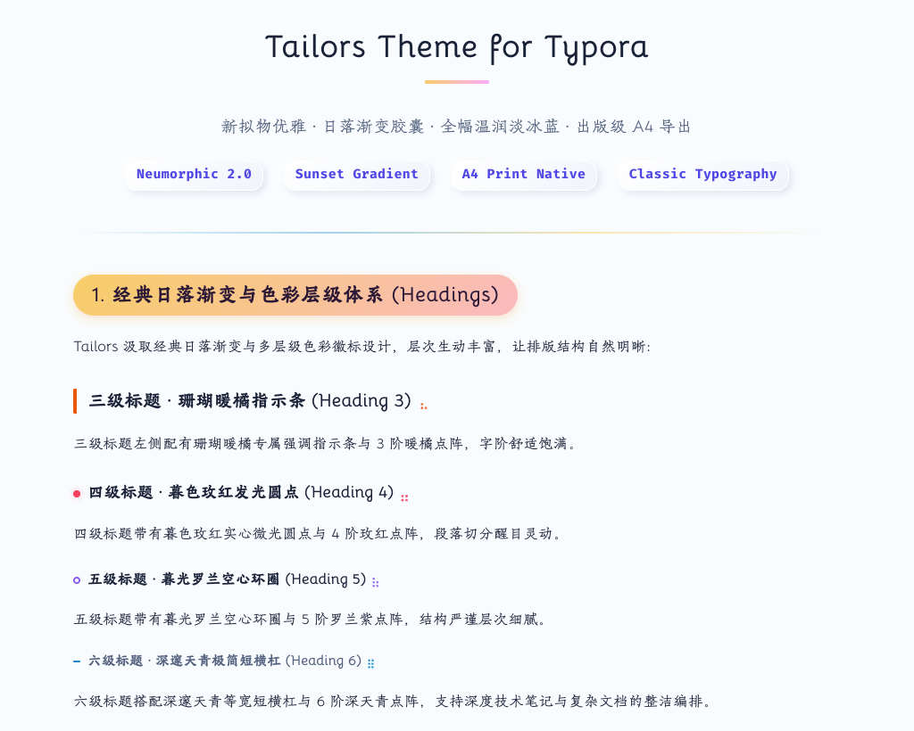
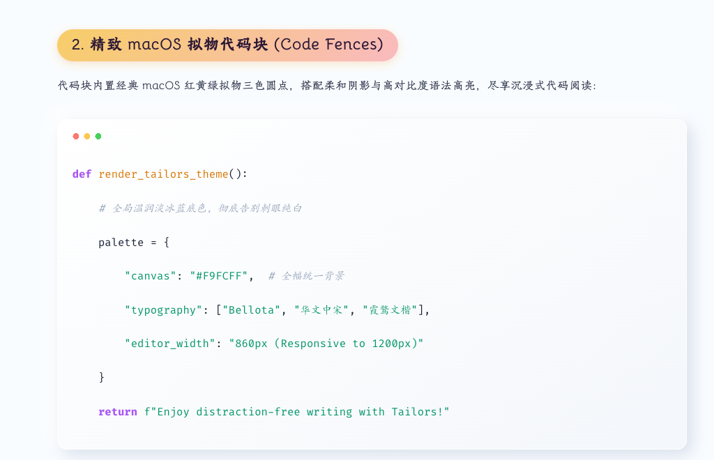
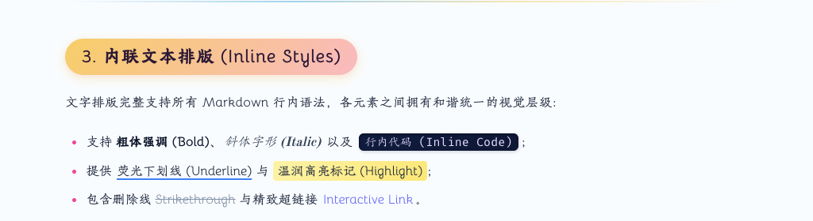
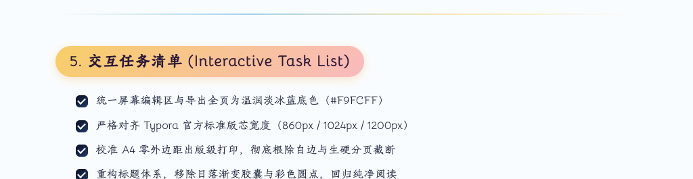

# Tailors — Typora Theme

<p align="center">
  <b>日落天色渐变 × 新拟态立体光影 2.0 × 全幅温润淡冰蓝 × 出版级 A4 跨页导出</b>
</p>

<p align="center">
  <a href="https://chiamzhang.github.io/TyporaTheme-Tailors/">🌐 在线效果预览 (Live Preview)</a> •
  <a href="https://github.com/ChiamZhang/TyporaTheme-Tailors">🏠 项目主页 (GitHub)</a> •
  <a href="Typora-Theme-Tailors%20中文介绍.md">🇨🇳 中文介绍</a> •
  <a href="https://github.com/ChiamZhang/TyporaTheme-Tailors/archive/refs/heads/main.zip">⬇️ 下载主题包 (ZIP)</a> •
  <a href="https://github.com/ChiamZhang/TyporaTheme-Tailors/issues">💬 反馈与建议</a>
</p>

---

## 🔗 Quick Links

- **Live Preview / 在线实时预览**: [https://chiamzhang.github.io/TyporaTheme-Tailors/](https://chiamzhang.github.io/TyporaTheme-Tailors/)
- **HomePage / 项目主页**: [https://github.com/ChiamZhang/TyporaTheme-Tailors](https://github.com/ChiamZhang/TyporaTheme-Tailors)
- **Download / 主题下载**: [TyporaTheme-Tailors.zip](https://github.com/ChiamZhang/TyporaTheme-Tailors/archive/refs/heads/main.zip)
- **Chinese Docs / 中文说明**: [Typora-Theme-Tailors 中文介绍.md](Typora-Theme-Tailors%20中文介绍.md)

---

## 📖 Introduction

**Tailors** is an elegant, publication-ready Typora theme that fuses the iconic **Sunset Gradient** (inspired by *Phycat*) with tactile, refined **Neumorphism 2.0** (inspired by *Typora-Theme-Neumorphism*).

Designed for long-form writers, researchers, and engineers, Tailors eliminates harsh white cutouts and distracting high-saturation accents, providing a seamless `#F9FCFF` ice-blue canvas, authentic classical typography, and mathematically calibrated print/PDF pagination.

---

## 🎨 Visual Showcase

### 1. Sunset Twilight Hierarchy & Dot Patterns (H1 ~ H6)
- **H1 Centered Title**: Anchored with a signature sunset gradient indicator underline;
- **H2 Capsule Badge**: Iconic `linear-gradient(135deg, #f7ce68, #fbabfe)` pill badge with soft neumorphic depth;
- **H3 ~ H6 Sunset Twilight Palette**: 
  - **H3 Coral Sunset Orange (`#ea580c`)**: Left accent bar accompanied by a 3-dot amber pattern;
  - **H4 Twilight Rose (`#f43f5e`)**: 8px solid glowing dot accompanied by a 4-dot rose pattern;
  - **H5 Iris Violet (`#8b5cf6`)**: 8px delicate hollow ring accompanied by a 5-dot violet pattern;
  - **H6 Midnight Azure (`#0284c7`)**: 8px minimal horizontal dash accompanied by a 6-dot azure pattern.



---

### 2. Refined macOS-Style Code Fences
- Embedded classic **macOS red/yellow/green triple-dot controls**;
- Soft neumorphic drop shadow (`box-shadow: 8px 8px 24px rgba(166, 180, 204, 0.28), -8px -8px 24px #fff`);
- WCAG-tested high-contrast syntax highlighting for sustained code-reading comfort.



---

### 3. Tactile Inline Formatting & `<var>` Badges
- **`<var>` Neumorphic Capsules**: Tactile raised pill badges with smooth concave inset on hover;
- **Deep-Ink Inline `code`**: Concave dark navy groove (`#101c3e`) with fresh lilac text (`#e6dcff`);
- **Sky-Blue Underlines (`<u>`)**: Clean `#3b82f6` fluorescent underline离底 3.5px, replacing gloomy pure black lines.



---

### 4. Neumorphic Blockquotes & Sunset Tables
- **Blockquote**: Raised neumorphic card with floating signature decorative bubbles that glow warm sunset amber on hover;
- **Sunset Table**: Gradient headers with gentle zebra striping and row hover micro-elevation.


---

### 5. Interactive 3D Task Lists
- **Unchecked**: 3D convex micro-button with natural light/shadow depth;
- **Checked**: Sunken concave groove with a crisp white checkmark and smooth strikethrough text.



---

## ✨ Key Features & Enhancements

- 🎨 **Full-Bleed Icy Blue Canvas** — The entire window and export output share the soothing `#F9FCFF` tone, completely eliminating stark white cutouts.
- 📐 **Aligned with Official Typora Standards** — Standard `860px` reading measure with responsive expansion to `1024px` (>1400px) and `1200px` (>1800px).
- 🖨️ **Publisher-Grade PDF Export** —
  - Default standard XiaoSi (小四号) body font size (`12pt / 16px`) with `1.65` line height;
  - Clean page-break algorithms (`break-inside: auto`) prevent awkward multi-page blank gaps;
  - Strips all heavy neumorphic shadows in print mode for ink-saving, crisp publication output.
- 🔤 **Authentic Classical Typography** — Bundles offline fonts (`Bellota`, `Tw Cen MT`, `HYHuaGuan`, `霞鹜文楷`, `华文中宋`) inside `tailors/`.

---

## 📦 Installation & Usage

1. Click **[Download Theme (main.zip)](https://github.com/ChiamZhang/TyporaTheme-Tailors/archive/refs/heads/main.zip)** and extract the archive.
2. In Typora, open the theme directory:
   - **macOS**: `Typora` → `Preferences` → `Appearance` → `Open Theme Folder`
   - **Windows / Linux**: `File` → `Preferences` → `Appearance` → `Open Theme Folder`
3. Copy:
   - `tailors.css`
   - `tailors` directory
   directly into the theme folder.
4. Restart Typora and select **Tailors** from the **Themes** menu.

> 💡 **Notice**: Designed and tested on macOS. Fully functional on Windows and Linux (cross-platform compatible).

---

## ⚙️ Customization

All primary gradients, colors, font stacks, and layout dimensions are organized in the `:root` block at the top of `tailors.css`:

```css
:root {
  --primary-gradient: linear-gradient(135deg, #f7ce68 0%, #fbabfe 100%);
  --bg-color: #F9FCFF;
  --max-width: 860px;
}
```

---

## 💡 Acknowledgements & Credits

- [Phycat](https://github.com/sumruler/typora-theme-phycat) by XuJilong — *Inspiration for the title hierarchy and sunset gradient.*
- [Typora-Theme-Neumorphism](https://github.com/Soanguy/Typora-Theme-Neumorphism) by Soanguy — *Inspiration for tactile neumorphic styling.*

---

## 📄 License

Distributed under the [MIT License](LICENSE).
