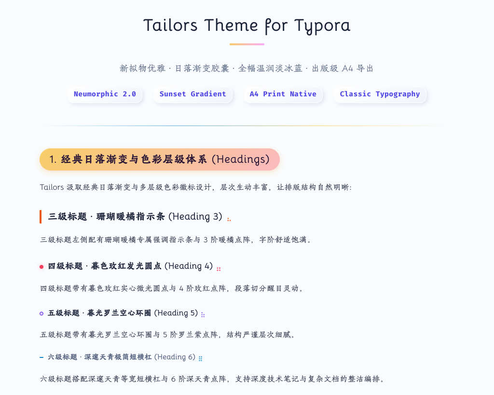
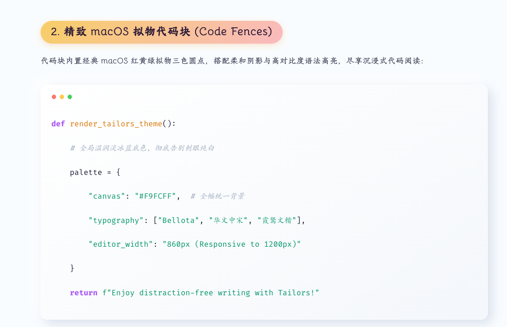
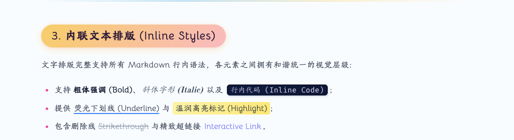
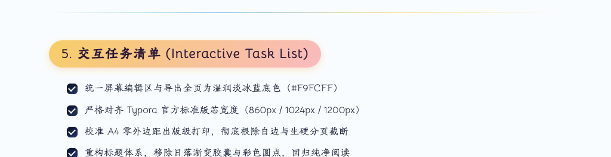

# Typora-Theme-Tailors 官方中文介绍

<p align="center">
  <b>日落天色渐变 × 新拟态立体光影 2.0 × 全幅温润淡冰蓝 × 出版级 A4 跨页导出</b>
</p>

<p align="center">
  <a href="https://chiamzhang.github.io/TyporaTheme-Tailors/">🌐 在线效果预览 (Live Preview)</a> •
  <a href="https://github.com/ChiamZhang/TyporaTheme-Tailors">🏠 项目主页 (GitHub)</a> •
  <a href="README.md">🌐 English Documentation</a> •
  <a href="https://github.com/ChiamZhang/TyporaTheme-Tailors/archive/refs/heads/main.zip">⬇️ 下载最新主题包 (ZIP)</a> •
  <a href="https://github.com/ChiamZhang/TyporaTheme-Tailors/issues">💬 提交 Issue</a>
</p>

---

## 🔗 快速链接

- **在线效果预览 (Live Preview)**: [https://chiamzhang.github.io/TyporaTheme-Tailors/](https://chiamzhang.github.io/TyporaTheme-Tailors/)
- **项目主页**: [https://github.com/ChiamZhang/TyporaTheme-Tailors](https://github.com/ChiamZhang/TyporaTheme-Tailors)
- **主题包下载**: [TyporaTheme-Tailors.zip](https://github.com/ChiamZhang/TyporaTheme-Tailors/archive/refs/heads/main.zip)
- **英文文档 (English)**: [README.md](README.md)

---

## 📖 主题简介

**Tailors** 是一款专为 Typora 深度写作与出版打造的高级主题。它融合了 **Phycat（物理猫）** 的经典日落渐变神髓与 **Typora-Theme-Neumorphism** 的新拟态 2.0 柔和立体光影，并在色彩工学、阅读字阶与 PDF 分页算法上进行了全方位的现代工程重构。

- **温润淡冰蓝**：全幅统一 `#F9FCFF`，告别刺眼纯白反光；
- **新拟态光影 2.0**：行内代码深邃凹槽、`<var>` 凸起浮雕胶囊、3D 复选框与装饰气泡；
- **出版级 A4 导出**：正文默认小四号（12pt / 16px），彻底消除跨页大面积空白断层。

---

## 🎨 视觉效果展示 (Visual Showcase)

### 1. 日落天色标题体系与点阵图案 (H1 ~ H6)
- **H1 居中大标题**：底部配有专属日落渐变强调指示线；
- **H2 标志性日落渐变胶囊**：经典 `linear-gradient(135deg, #f7ce68, #fbabfe)` 药丸徽标与微凸起质感；
- **H3 ~ H6 日落天色进阶色彩标示与灵动点阵图案**：
  - **H3 珊瑚暖橘 (`#ea580c`)**：左侧精致高亮边框与 3 阶暖橘点阵；
  - **H4 暮色玫红 (`#f43f5e`)**：8px 实心微光圆点徽标与 4 阶玫红点阵；
  - **H5 暮光罗兰 (`#8b5cf6`)**：8px 精致空心环圈标示与 5 阶罗兰紫点阵；
  - **H6 深邃天青 (`#0284c7`)**：8px 极简等宽短横杠与 6 阶深天青点阵。



---

### 2. 精致 macOS 拟物代码块 (Code Fences)
- 代码块顶部内置经典 **macOS 红黄绿三色拟物圆点徽标**；
- 柔和新拟物外层投影搭配高对比度语法高亮，长久阅读依然舒适清晰。



---

### 3. 内联文本排版与 `<var>` 拟物胶囊
- **`<var>` 微拟物胶囊**：经典触感凸起浮雕药丸，悬停顺滑转为内凹凹槽；
- **行内代码 `code`**：深邃暗夜微凹槽（`#101c3e` 底色 + 浅紫文字），辨识度极高；
- **清新荧光下划线 (`<u>`)**：晴空蓝高亮离底 3.5px，去除沉闷纯黑下划线。



---

### 4. 引用块与日落渐变表格
- **新拟态引用块**：双重拟物阴影浮雕卡片，悬停转为柔和内凹；右下角重现标志性双圆气泡（经优化尺寸为 1.8rem/1rem，鼠标悬停泛出日落金光，且彻底杜绝遮挡文字）；
- **日落渐变表格**：日落渐变表头、圆角卡片底托与交替浅色斑马纹。


---

### 5. 交互式 3D 任务列表 (Task Lists)
- **未勾选态**：3D 凸起微按钮，带有自然双层光影；
- **已勾选态**：下沉为深邃内凹凹槽，内部呈现利落居中的白色对勾与柔和划线。



---

## ✨ 核心特性与工程升级

1. 🎨 **全幅一体化温润底色**：
   - 彻底去除白卡片突兀边缘，屏幕阅读与 PDF 导出均覆盖 `#F9FCFF` 温润淡冰蓝。
2. 📐 **对齐 Typora 官方标准排版宽度**：
   - 默认标准 `860px` 舒适阅览宽度；超宽屏自适应扩展至 `1024px` 与 `1200px`。
3. 🖨️ **出版级 PDF / 打印跨页导出优化**：
   - 导出正文默认标准小四号字体（12pt / 16px），行高 1.65；
   - 彻底修复了旧版因 fixed 图层与 `min-height: 100%` 导致的第二页大面积顶部空白问题；
   - 导出态自动剥离所有拟物投影，打印墨粉清晰，线条精简干练。
4. 🔤 **古典正字字系全包离线嵌入**：
   - 完整保留 `Bellota`、`华文中宋`、`霞鹜文楷`、`Tw Cen MT`、`HYHuaGuan` 等字体，字体资源存放于 `tailors/` 目录，开箱即用。

---

## 📦 安装与使用指南

1. 点击 **[下载主题包 (main.zip)](https://github.com/ChiamZhang/TyporaTheme-Tailors/archive/refs/heads/main.zip)** 并解压。
2. 打开 Typora 主题目录：
   - **macOS**: `Typora` → `偏好设置` → `外观` → `打开主题文件夹`
   - **Windows / Linux**: `文件` → `偏好设置` → `外观` → `打开主题文件夹`
3. 将解压出的：
   - `tailors.css` 文件
   - `tailors` 字体文件夹
   直接拷贝到该主题文件夹中。
4. 完全重启 Typora，在菜单栏 **“主题”** 中勾选 **Tailors** 即可生效。

> 💡 **平台说明**：本主题在 macOS 上深度设计与测试，已进行全平台样式适配，可完美兼容 Windows 与 Linux 系统。

---

## ⚙️ 个性化定制

如需微调日落渐变色、字体栈或版芯宽度，只需打开 `tailors.css` 修改顶部的 `:root` 变量：

```css
:root {
  --primary-gradient: linear-gradient(135deg, #f7ce68 0%, #fbabfe 100%);
  --bg-color: #F9FCFF;
  --max-width: 860px;
}
```

---

## 💡 致谢与参考

- **物理猫 Phycat** 作者：XuJilong — [GitHub 仓库](https://github.com/sumruler/typora-theme-phycat)（*主要参考了标题体系与日落渐变色调*）
- **Typora-Theme-Neumorphism** 作者：Soanguy — [GitHub 仓库](https://github.com/Soanguy/Typora-Theme-Neumorphism)（*主要参考了新拟态触感交互设计*）

---

## 📄 开源许可证

遵循 [MIT License](LICENSE) 开源协议。
